<!--
author: ITVET Academic Skills Training
version: 1.2
language: en
narrator: US English Female
comment: Visual, hands-on Zotero training for university students. Includes illustrated explanations and hands-on classroom demonstrations; no quizzes.
-->

# Zotero for Academic Research

## Visual Student Training · Beginner to Advanced

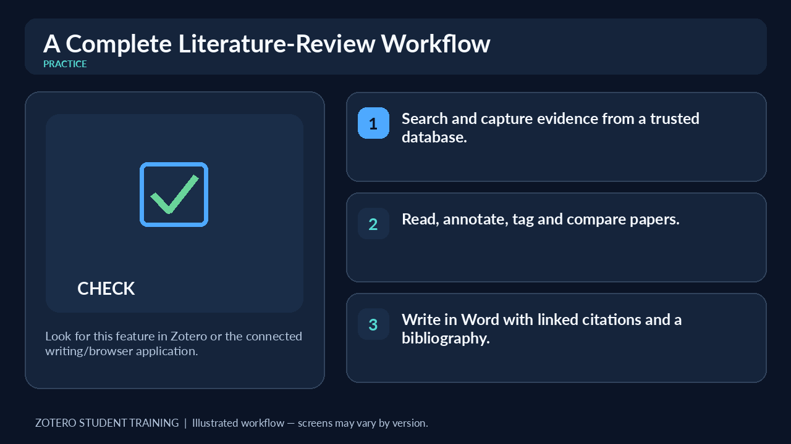

> **Format:** Hands-on LiaScript course · **Suggested time:** 2.5–3 hours · **Level:** University students · **Requirements:** Zotero, Chrome with Zotero Connector, and optionally Microsoft Word.

{{|>}}
Welcome! In this training you will build a research library, collect publications from Chrome, read and annotate PDFs, write structured research notes, and cite your sources in a Word document. Pause after each demonstration to perform the activity on your own computer.

**Learning outcomes** — by the end, you should be able to:

1. Install Zotero and Zotero Connector and identify their different roles.
2. Create collections, tags and saved searches for a research topic.
3. Capture valid references, import PDFs and verify bibliographic metadata.
4. Read, highlight and take linked notes in the PDF reader.
5. Generate accurate Zotero-linked citations and reference lists in Word.
6. Sync and share references responsibly, and explain key limitations.

**Important for visuals:** This course includes actual Zotero screenshots supplied for this training and separate **illustrated workflow diagrams**. The diagrams illustrate where/how features are used; they are not exact screenshots of every software version.

---

# 1. Getting Started and Setup

# 1.1 What is Zotero?

**Zotero is a reference manager**, not a search engine and not an automatic thesis writer. It records academic sources and helps you organize, read, annotate and cite them. It can store PDFs when you have access to those files.

| Research activity | Zotero tool |
|---|---|
| Find papers on the web | Chrome + Zotero Connector |
| Save publication metadata | Connector / Add by Identifier |
| Organize sources | Collections + Tags |
| Read and annotate | Built-in PDF Reader + Notes |
| Write references | Word Zotero Add-in |
| Collaborate | Group Libraries |

# Install Zotero + Connector

**Try this procedure:**

1. Download Zotero from zotero.org/download.
2. Run the Windows installer or move the Mac app to Applications.
3. Add Zotero Connector to Chrome and pin the icon.

**Desktop Zotero** stores and manages your research library. **Zotero Connector** is a *separate browser extension* for capturing sources while browsing.

- Windows: download Zotero, run the installer, then open Zotero from Start.
- macOS: open the `.dmg` and drag Zotero to Applications.
- Chrome: install and pin Zotero Connector from the official download page. Check the publisher before installing.
- Official URLs: [Zotero Downloads](https://www.zotero.org/download/) · [Chrome Connector](https://chromewebstore.google.com/detail/zotero-connector/ekhagklcjbdpajgpjgmbionohlpdbjgc).

**Classroom task:** find the Zotero app and browser Connector. Explain which one captures browser records and which one manages them.

# Accounts and Library Sync

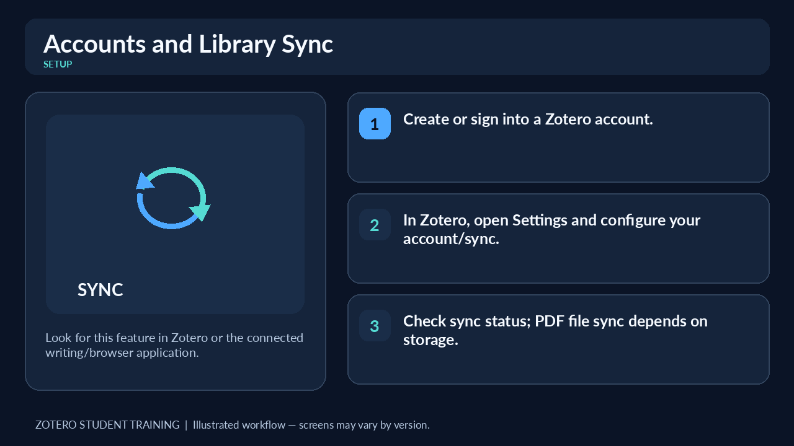

**Try this procedure:**

1. Create or sign into a Zotero account.
2. In Zotero, open Settings and configure your account/sync.
3. Check sync status; PDF file sync depends on storage.

Using Zotero offline does **not** require an account. Sign in when you want to sync metadata and notes between computers. File synchronization has its own capacity limits and settings.

**Classroom task:** locate the sync indicator and explain the difference between a locally stored PDF and a PDF synchronized to cloud storage.

---

# 2. Navigating Zotero

# 2.1 Every Zotero symbol: real screenshot walkthrough

This is an annotated guide to the **Zotero interface in the supplied classroom screenshot**. Your version may look slightly different, but each symbol below has a specific role. Students should keep Zotero open as they follow along.

**Key principle:** Zotero has three panels. The left organizes your research, the middle lists sources, and the right displays the details of the selected source. In this screenshot, **Master Thesis** contains one item and no item is currently selected, so its detail pane is empty.

# 2.2 Left panel — all library icons

| No. | Exact symbol / label | What it does | Student demonstration |
|:--:|---|---|---|
| 1 | Folder with plus: **New Collection** | Creates a research collection (folder). | Create `Literature Review`. |
| 2 | Magnifying glass above folders | Searches the collection list by name. | Find `Master Thesis`. |
| 3 | University/library building: **My Library** | Shows all references stored in your personal library, including items in collections. | Click it and compare with the selected folder. |
| 4 | Clock: **Recently Read** | Lists sources opened recently. | Read a PDF, then return to this view. |
| 5 | Small `>`/`v` arrow next to collection | Expands or collapses its subcollections. | Add and reveal a subcollection. |
| 6 | Blue folder: **Master Thesis** | The currently selected collection; clicking it shows its contents in the center. | Create a subcollection for methodology. |
| 7 | Green page: **My Publications** | Holds records of works you authored or co-authored. | Explain why it differs from a literature collection. |
| 8 | Overlapping orange pages: **Duplicate Items** | Finds likely duplicate references so they can be reviewed and merged. | Check before citing the same paper twice. |
| 9 | Orange/red pages: **Unfiled Items** | Lists items in My Library not assigned to any collection. | File a source into Master Thesis. |
| 10 | Trash can: **Bin** | Holds deleted references for recovery or permanent deletion. | Explain recovery versus permanent removal. |

**Important:** A collection does not create a separate copy of the reference. The same reference can appear in more than one collection.

# 2.3 Middle panel — adding and finding research

| No. | Exact symbol / label | Purpose | Student demonstration |
|:--:|---|---|---|
| 11 | Paper with plus and dropdown: **New Item** | Manually creates a Book, Journal Article, Report or other bibliographic record. | Add a journal article and fill title/author/year. |
| 12 | Magic wand: **Add Item(s) by Identifier** | Retrieves publication metadata from DOI, ISBN or other supported identifier. | Paste a valid DOI for an existing paper. |
| 13 | Stacked page plus: **Add Attachment** | Attaches a local file, stored copy, linked file, or supported web link to a selected reference. | Attach a PDF to an article record. |
| 14 | Note page with dropdown: **New Note** | Creates a note (standalone or attached to a source). | Write a two-sentence paper summary. |
| 15 | Magnifying glass + `All Fields & Tags` | Searches references; dropdown changes search scope. | Search a paper by author. |
| 16 | Funnel inside search box: **Advanced Search** | Applies several filter conditions, such as item type, tag or author. | Filter for journal articles with a selected tag. |
| 17 | **Title** heading | Displays the title of each reference; click to change sort order. | Sort alphabetically. |
| 18 | **Creator** heading | Displays authors/creators; click to sort by creator. | Sort by author surname. |
| 19 | Small paperclip column heading | Indicates attachments associated with items. | Compare a source with and without attached PDF. |
| 20 | Blue book icon on the item row | Indicates an item whose reference type is **Book**. | Click it to display its metadata on the right. |

The small down arrows beside toolbar buttons open additional choices. The paperclip near the column headings is **not** the same control as Add Attachment: one is a list indicator and one is an action.

# 2.4 Right panel — all reference-detail symbols

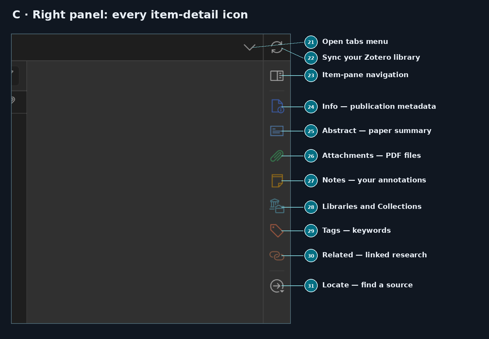

| No. | Symbol | Purpose | When students use it |
|:--:|---|---|---|
| 21 | Down chevron near the top right | Opens the Zotero tab list/menu. | Switch between open library and reader tabs. |
| 22 | Circular arrows: **Sync** | Synchronizes library information with your Zotero account when configured. | Sync after saving a new paper. |
| 23 | Split-panel rectangle | Controls the item-pane side navigation. | Show or hide the icon rail. |
| 24 | Blue document + `i`: **Info** | Shows editable bibliographic metadata: item type, title, author, date, publication, DOI, etc. | Correct a missing publication year. |
| 25 | Blue lines: **Abstract** | Shows the abstract of a selected article, when available. | Read the abstract before deciding relevance. |
| 26 | Green paperclip: **Attachments** | Shows a reference's PDFs, links, files and previews. | Open an attached PDF. |
| 27 | Yellow note: **Notes** | Displays and creates notes linked to a reference. | Add a research limitation. |
| 28 | Library building + folder: **Libraries and Collections** | Shows where a reference is stored and which collections contain it. | Confirm a paper is in the methodology collection. |
| 29 | Orange tag: **Tags** | Adds subject keywords and classification tags. | Add `quantitative`, `methodology`, or `read`. |
| 30 | Chain: **Related** | Creates links between conceptually related references. | Connect two papers using different methods. |
| 31 | Arrow/circle: **Locate** | Offers ways to locate the item, such as online or through library lookup where configured. | Find a source from its citation. |

The right pane is blank in the screenshot because a collection, rather than an individual item, is selected. **Click the book icon in the center** to see Info, Abstract and other details.

# 2.5 Bottom-left corner — tag controls

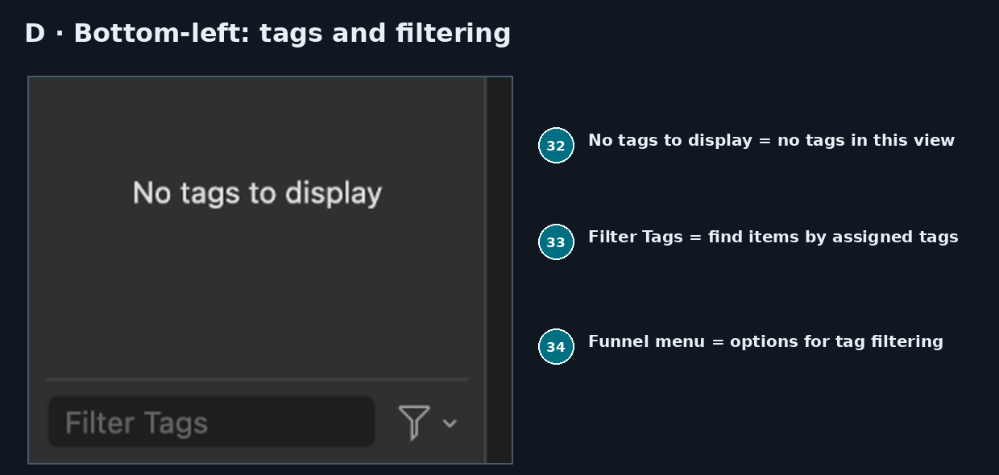

| No. | Symbol / text | Purpose |
|:--:|---|---|
| 32 | **No tags to display** | The tag selector currently has no tags to show in this view. |
| 33 | **Filter Tags** text field | Narrows the displayed tag list by text; clicking a tag filters items. |
| 34 | Funnel + dropdown | Opens tag-selector filtering/display options. |

At the bottom-right, **“1 item in this view”** means one Zotero item is visible in the current collection. It is a count, not an additional research tool.

# 2.6 Suggested classroom live demonstration — no quiz

1. Click **Master Thesis** and show the single reference.
2. Click the **blue book icon**. Explain that the right-side **Info** section now shows the source's metadata.
3. Open **Abstract**, **Attachments**, **Notes**, **Tags**, and **Related** one by one. Explain why each is useful for a literature review.
4. Click **New Collection**, create `Research Methodology`, and return to the main collection.
5. Click **New Item** to demonstrate a manual record, then demonstrate **Add Item(s) by Identifier** using a genuine DOI.
6. Attach a PDF, add a note, assign two tags, and run an advanced search with the funnel icon.
7. Show **Duplicate Items**, **Unfiled Items**, and **Bin**; explain which records appear there and why.
8. Finally, click **Sync** and explain that PDF-file syncing depends on settings and available storage.

**Instructor tip:** Have students hover over each icon to read Zotero's own tooltip. Some versions change the icon position while preserving the same function.

---

# 2.1 Real Zotero interface

The screenshot above is from an installed Zotero application. The **left** side contains the library and collections; the **middle** lists references; the **right** displays details for the selected item.

**Instructor demonstration:** select a collection, select a paper, and switch between the Info, Notes and Tags options for that paper.

# Three-Panel Zotero Interface

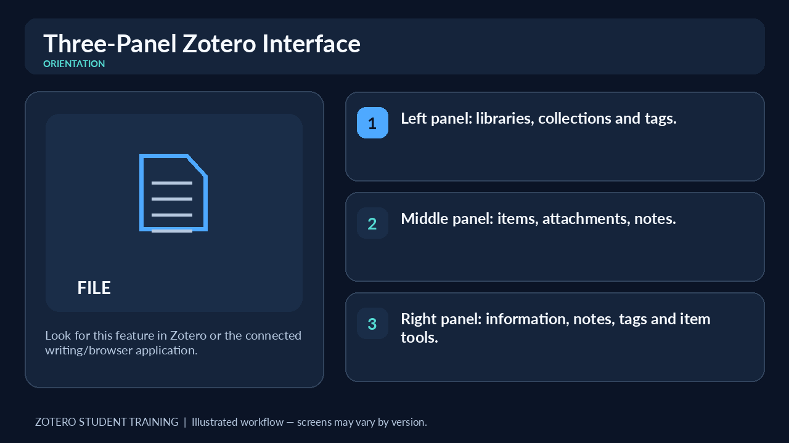

**Try this procedure:**

1. Left panel: libraries, collections and tags.
2. Middle panel: items, attachments, notes.
3. Right panel: information, notes, tags and item tools.

The Zotero window is divided into three important sections: **Library/collections** on the left, **items list** in the middle, and **item details** on the right. A PDF reader opens when you open an attached PDF.

**Classroom task:** select one item and describe where its title, tags, and attached PDF appear.

# 2.2 Find the real toolbar

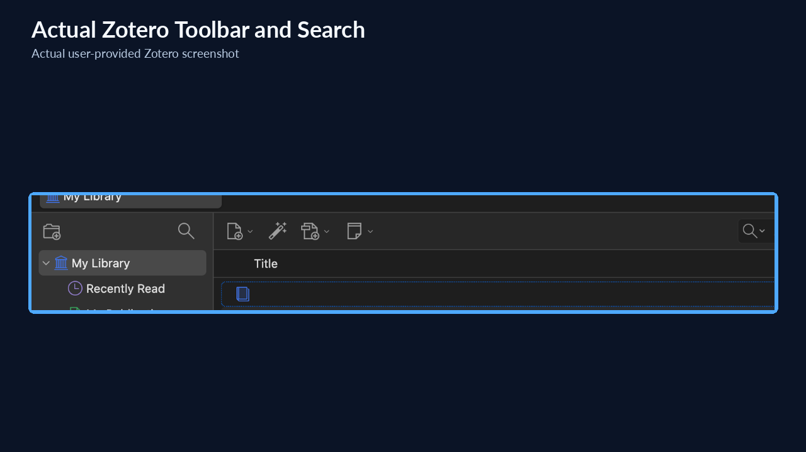

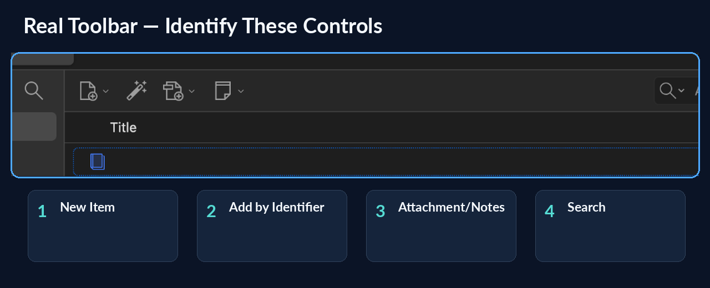

The toolbar in an actual installation may show some actions under menu buttons; labels and placement vary by version.

# Main Zotero Toolbar

**Try this procedure:**

1. New Collection: organize references in folders.
2. New Item and Add by Identifier: create records.
3. New Note, Attachments and Search: work with sources.

Tool names and icon arrangements can vary slightly by Zotero version. Learn the **function**, not only the icon shape.

| Tool | Purpose |
|---|---|
| New Collection | Create a project folder / subcollection |
| New Item | Add a reference manually |
| Add by Identifier (magic wand) | Retrieve metadata from DOI, ISBN, PMID and supported IDs |
| New Note | Capture thoughts and reading notes |
| Add Attachment (paperclip) | Add a PDF, file, link, or related attachment |
| Search | Find references and PDF text within the library |

**Classroom task:** locate each of these features in your own Zotero interface.

---

# 3. Build Your Research Library

# 3.1 Example: real collection structure

For practice you may use **any subject**. The screenshot shows a sustainability/curriculum research structure; you can replace these folders with your own thesis or assignment themes.

# Collections and Subcollections

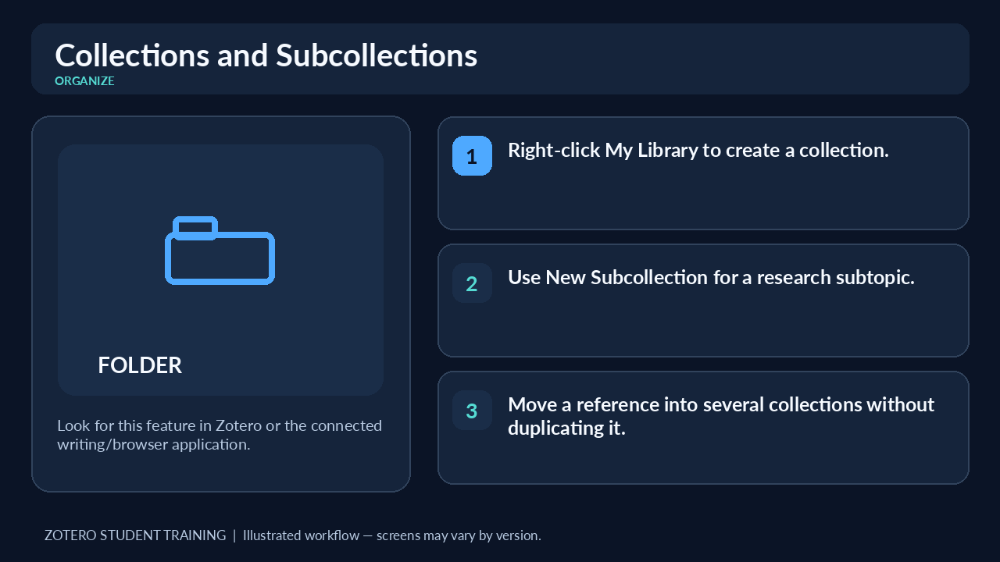

**Try this procedure:**

1. Right-click My Library to create a collection.
2. Use New Subcollection for a research subtopic.
3. Move a reference into several collections without duplicating it.

Collections organize references, not copies of files. **My Library** contains your complete library even when an item belongs to multiple collections.

**Practice:** create `Research Project` → `Background`, `Methods`, `Results`. Add one paper to two collections. Check it is still only one library item.

# Tags and Color Labels

**Try this procedure:**

1. Choose a reference and open Tags.
2. Add tags such as Method: Qualitative or Read Next.
3. Use the tag selector to filter references by topic.

Use tags to represent **cross-cutting themes**, while collections represent project organization. Example tags: `To Read`, `Read`, `Method-Qualitative`, `Method-Quantitative`, `GCI`, `Limitations`, `Key Source`.

**Practice:** add `Read` and `Method-Qualitative` to a source and locate it with the tag selector.

# Sort Items and Use Related

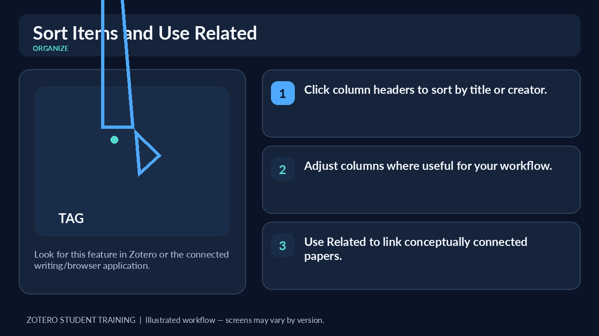

**Try this procedure:**

1. Click column headers to sort by title or creator.
2. Adjust columns where useful for your workflow.
3. Use Related to link conceptually connected papers.

Sort from item-list column headings; visible columns depend on your layout. The **Related** feature is useful for linking a methods paper to a theoretical framework or counterargument.

**Practice:** sort by creator or date, then link two conceptually related papers.

# Related Items and Cross-Links

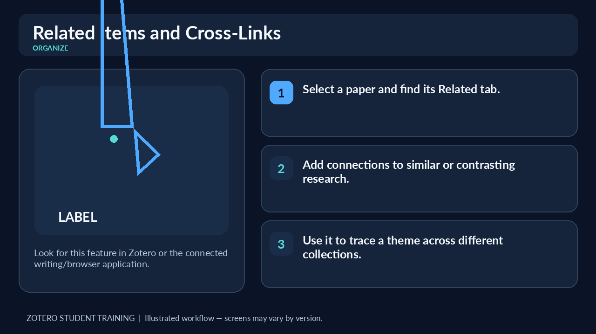

**Try this procedure:**

1. Select a paper and find its Related tab.
2. Add connections to similar or contrasting research.
3. Use it to trace a theme across different collections.

Use **Related Items** for *connections*, not merely for belonging to the same topic folder. For example, link a paper that proposes keyword matching to one that critiques its limitations.

**Practice:** connect two papers and write one sentence explaining their relationship in a note.

# Practice 1 — Library structure (10 minutes)

- [ ] Create one main collection named `Research Training`.
- [ ] Add subcollections named `Background`, `Methods`, and `Key Findings`.
- [ ] Add one paper to two collections, if available.
- [ ] Create tags `To Read`, `Read`, and `Important`.

---

# 4. Collect Papers from Chrome and Your Laptop

# Save a Single Article from Chrome

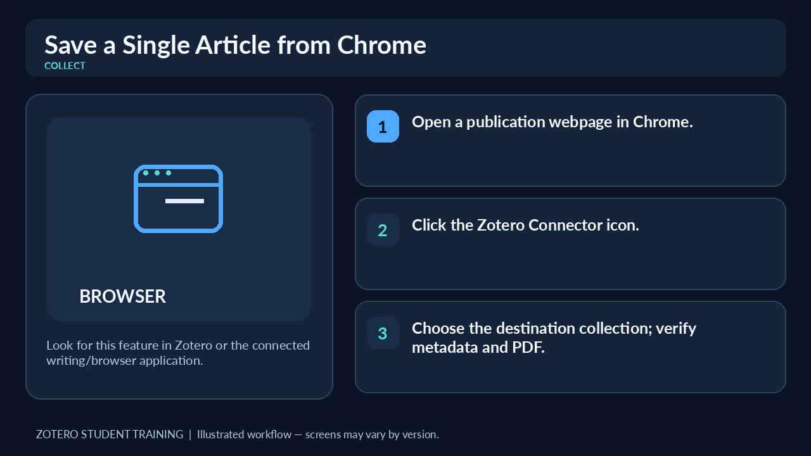

**Try this procedure:**

1. Open a publication webpage in Chrome.
2. Click the Zotero Connector icon.
3. Choose the destination collection; verify metadata and PDF.

Best practice: open the **article's actual publisher/database record page** before clicking Connector. Saving a generic webpage may create a webpage item rather than a journal article. Inspect the generated item type and metadata.

**Practice:** search Google Scholar for *education for sustainable development university curriculum*, open a relevant article page, then click the Connector.

# Save Multiple Search Results

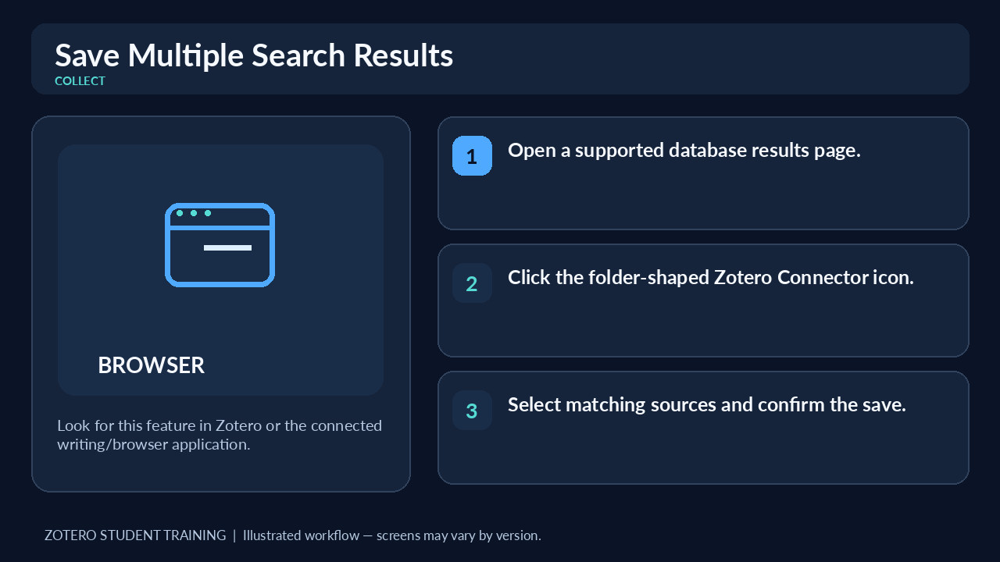

**Try this procedure:**

1. Open a supported database results page.
2. Click the folder-shaped Zotero Connector icon.
3. Select matching sources and confirm the save.

On supported search-results pages, the Connector often shows a **folder icon**. Select multiple items from its picker, but be selective: save only papers relevant to your research question. Not every result includes an accessible PDF.

**Practice:** select two relevant items and verify they appear in the chosen Zotero collection.

# Add by DOI, ISBN or PMID

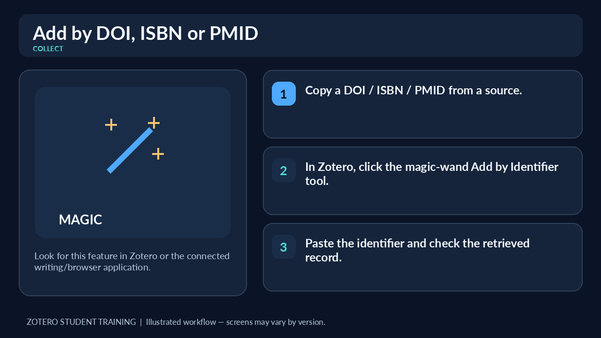

**Try this procedure:**

1. Copy a DOI / ISBN / PMID from a source.
2. In Zotero, click the magic-wand Add by Identifier tool.
3. Paste the identifier and check the retrieved record.

A **DOI** points to a publication record; it is not a full PDF. It often provides reliable bibliographic data. Use the magic-wand tool to enter a real identifier copied from a paper; Zotero retrieves data if that identifier resolves.

**Practice:** locate the DOI on a journal article page and add it by identifier; compare the imported metadata against the publisher page.

# Add an Item Manually

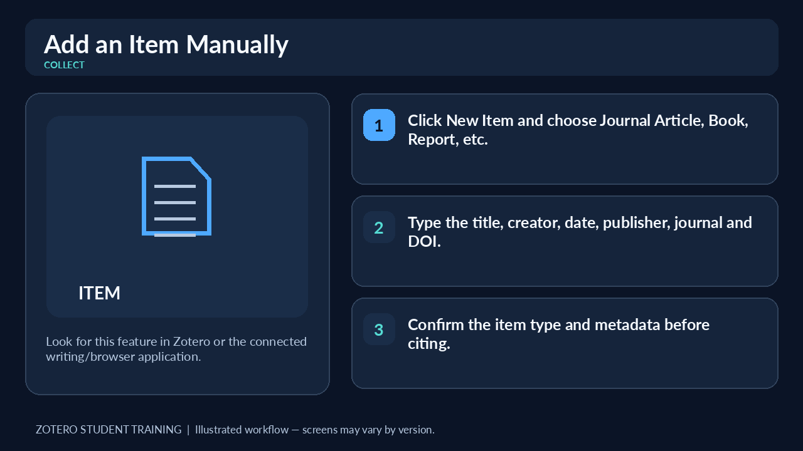

**Try this procedure:**

1. Click New Item and choose Journal Article, Book, Report, etc.
2. Type the title, creator, date, publisher, journal and DOI.
3. Confirm the item type and metadata before citing.

Manual entry is useful for unpublished reports, course materials or records that Zotero cannot capture automatically. Pick the correct **item type** first, because the available metadata fields depend on that choice.

**Practice:** create an example *Report* record with a hypothetical title, institution and year. Do not mix hypothetical records into your real thesis collection without marking them.

# Import a PDF

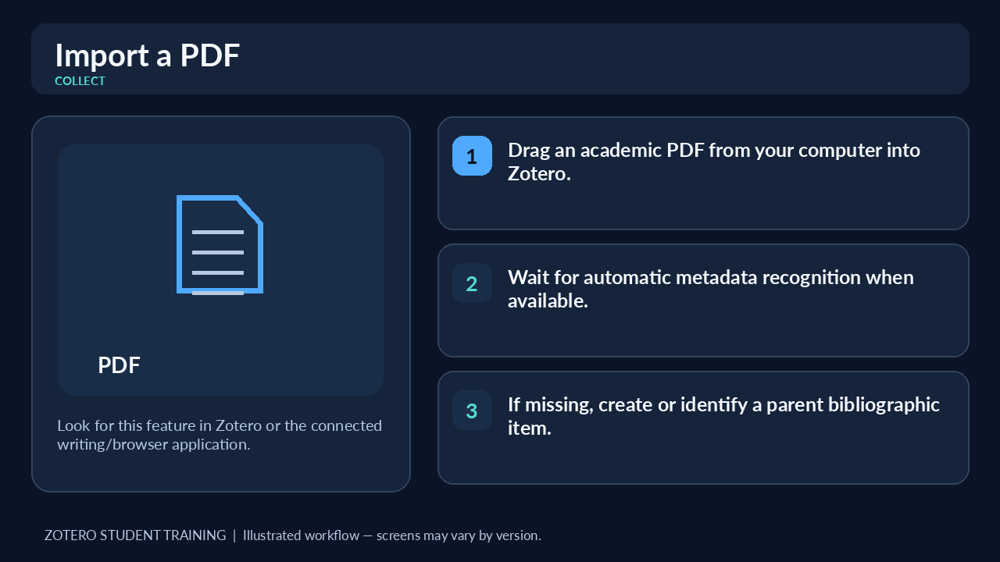

**Try this procedure:**

1. Drag an academic PDF from your computer into Zotero.
2. Wait for automatic metadata recognition when available.
3. If missing, create or identify a parent bibliographic item.

When you drag in a PDF, Zotero may automatically recognize the paper. If it remains a standalone attachment without a parent bibliographic entry, right-click and try **Retrieve Metadata for PDF** or **Create Parent Item** as available in your version. You may also attach the PDF to an existing record.

**Practice:** import one legally obtained PDF and check whether author and year are present.

# PDF Attachments and Links

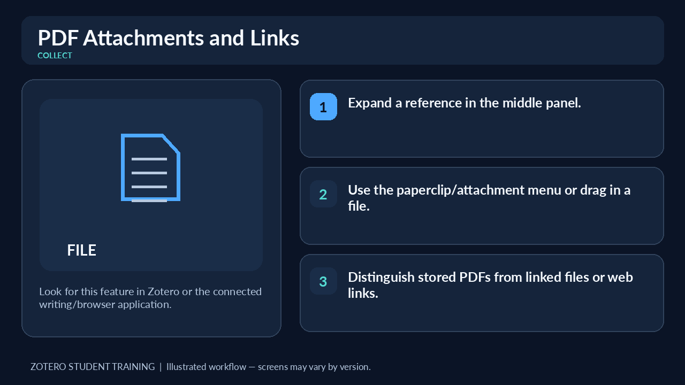

**Try this procedure:**

1. Expand a reference in the middle panel.
2. Use the paperclip/attachment menu or drag in a file.
3. Distinguish stored PDFs from linked files or web links.

A paper in Zotero can contain multiple children: a stored PDF, supplementary files, a snapshot, or notes. An **item's metadata record** and its **PDF attachment** are not the same thing. Some links need internet access, while stored files can be available locally.

**Practice:** expand one item and count its attachments.

# Understand Item Types

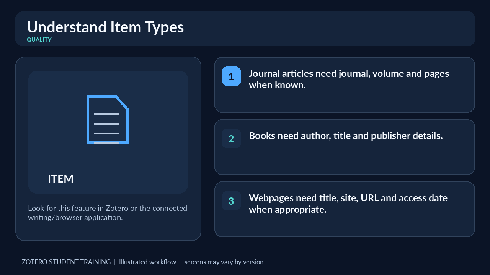

**Try this procedure:**

1. Journal articles need journal, volume and pages when known.
2. Books need author, title and publisher details.
3. Webpages need title, site, URL and access date when appropriate.

Citation formatting relies on correct **item type** and fields. A journal article is different from a conference paper, book chapter, thesis, website, or report. When you import a PDF, look at the item icon and the Info pane to confirm its type.

**Practice:** identify whether two different sources are journal articles, reports or web pages.

# Check Source Metadata

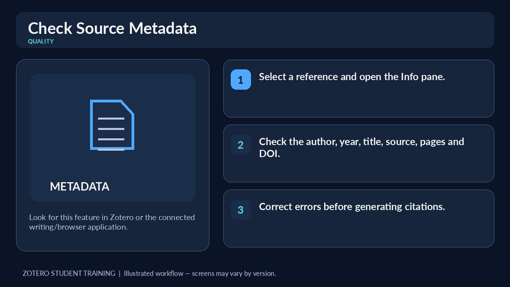

**Try this procedure:**

1. Select a reference and open the Info pane.
2. Check the author, year, title, source, pages and DOI.
3. Correct errors before generating citations.

Do not trust imported data automatically. Common issues include author fields saved incorrectly, a wrong year, missing journal volume, a generic webpage item, an incorrect title case, or a PDF with no parent item. Verify against the publisher's authoritative record.

**Practice:** correct one missing or inconsistent field in a practice record.

# Practice 2 — Capture and inspect (15 minutes)

- [ ] Use Google Scholar or a library database to locate three relevant papers.
- [ ] Save at least two with Zotero Connector.
- [ ] Add one using a DOI, if available.
- [ ] Open each item and check author, year, item type and DOI.
- [ ] Expand each item to see whether an accessible PDF was saved.

---

# 5. Find, Filter and Clean Your Sources

# Quick Search

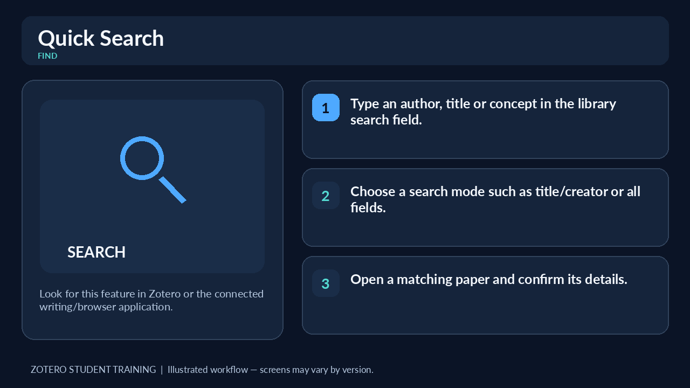

**Try this procedure:**

1. Type an author, title or concept in the library search field.
2. Choose a search mode such as title/creator or all fields.
3. Open a matching paper and confirm its details.

Quick Search helps you find known references. Depending on the mode selected, it can search title/creator/year, all fields and tags, or full text of indexed PDFs.

**Practice:** type a distinctive term from the title of an imported paper and open the matching record.

# Advanced Search and Saved Search

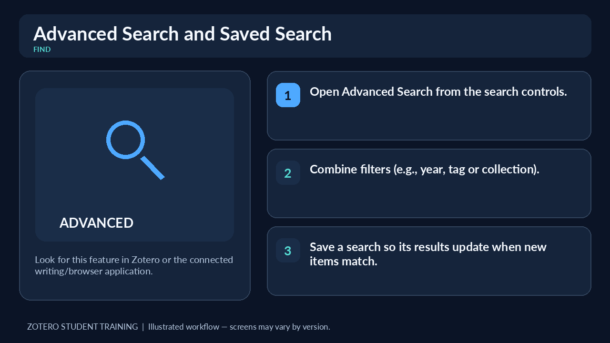

**Try this procedure:**

1. Open Advanced Search from the search controls.
2. Combine filters (e.g., year, tag or collection).
3. Save a search so its results update when new items match.

Advanced Search allows combinations such as `tag contains AI` **AND** `date is after 2020`. A saved search updates dynamically as new matching references are added.

**Practice:** create one saved search for items tagged `To Read`. Add a matching tag to another item and see whether the saved-search list changes.

# Find and Merge Duplicates

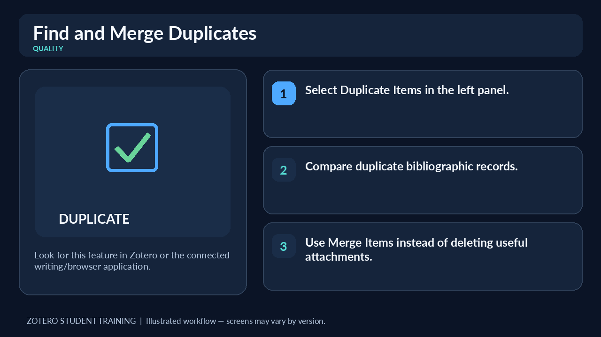

**Try this procedure:**

1. Select Duplicate Items in the left panel.
2. Compare duplicate bibliographic records.
3. Use Merge Items instead of deleting useful attachments.

Duplicates can appear when the same article is saved from a database and later added by DOI. Use **Duplicate Items** and inspect records before merging. Merging preserves a single item while consolidating useful metadata and attachments.

**Practice:** investigate whether two similar-looking titles are truly identical publications.

---

# 6. Read and Annotate Academic PDFs

# Open the Built-in PDF Reader

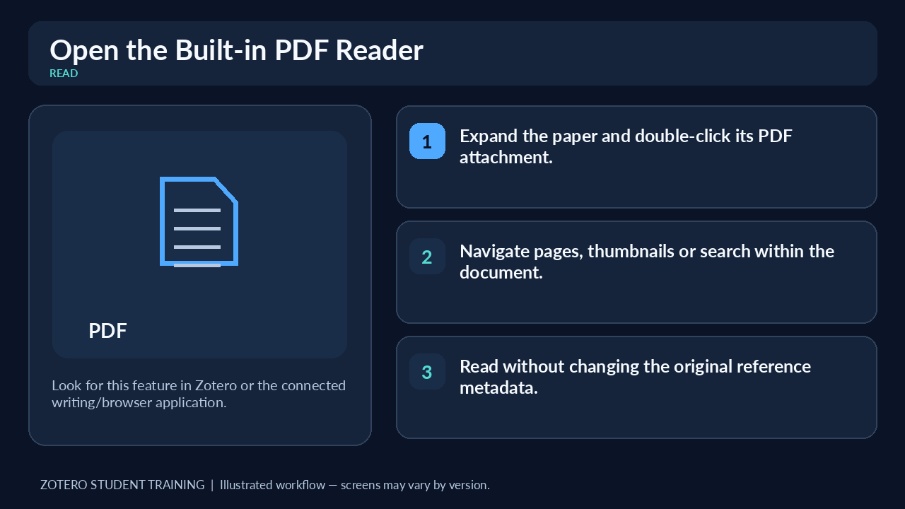

**Try this procedure:**

1. Expand the paper and double-click its PDF attachment.
2. Navigate pages, thumbnails or search within the document.
3. Read without changing the original reference metadata.

The integrated PDF reader supports selecting text, highlighting, annotation navigation, and linked notes. PDF reading features require the file to be present; saving a citation alone does not guarantee that Zotero downloaded the PDF.

**Practice:** open a PDF, find a research-method term with search, and navigate to that page.

# Highlight, Underline and Colors

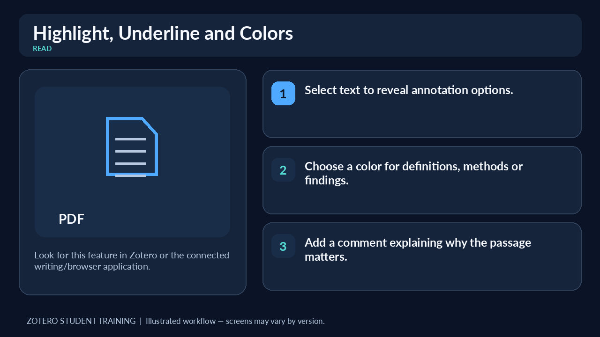

**Try this procedure:**

1. Select text to reveal annotation options.
2. Choose a color for definitions, methods or findings.
3. Add a comment explaining why the passage matters.

Recommended (not built-in) classroom color convention:

- **Yellow:** concepts / definitions
- **Blue:** methods / data
- **Green:** findings / evidence
- **Pink:** limitations / research gaps

A highlight is useful when accompanied by a **reason** or comment. Avoid highlighting whole pages without analysis.

**Practice:** annotate one definition, one method, one finding and one limitation.

# Area Annotation and PDF Notes

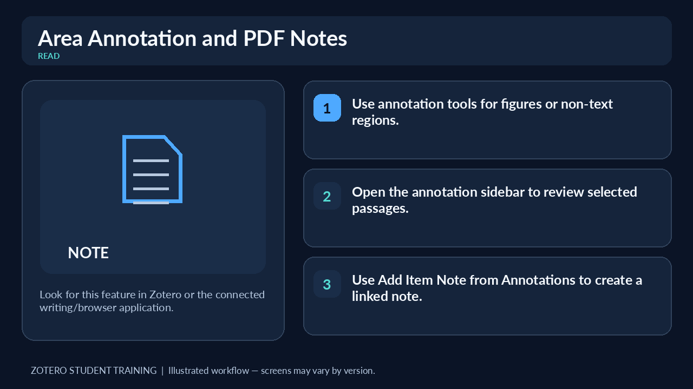

**Try this procedure:**

1. Use annotation tools for figures or non-text regions.
2. Open the annotation sidebar to review selected passages.
3. Use Add Item Note from Annotations to create a linked note.

Text selections, underlines, notes and area annotations can be converted or linked into note content. Use the PDF reader's Notes pane and choose an **Add ... Note from Annotations** command, depending on the context.

**Practice:** create a note from at least two PDF annotations and click a linked quotation to return to the source.

# Create Structured Research Notes

**Try this procedure:**

1. Create a child item note or a standalone note.
2. Summarize objectives, methods, findings and limitations.
3. Include your own interpretation; return to the linked PDF.

Suggested note template:

1. Full paper title / research objective
2. Theoretical framework
3. Research design and sample
4. Main findings with page references
5. Strengths and limitations
6. Relevance to your own question
7. Your interpretation (clearly distinguish your voice from the author's)

**Practice:** write an 80–120 word analytical note and link it to its source.

# Practice 3 — PDF analysis (15 minutes)

- [ ] Open a PDF in Zotero.
- [ ] Highlight one **definition**, one **method**, one **finding**, and one **limitation**.
- [ ] Convert the annotations to an item note.
- [ ] Write a 3–5 sentence summary in your own words.

---

# 7. Cite Correctly in Microsoft Word

# Zotero Tab in Microsoft Word

**Try this procedure:**

1. Open Word and look for the Zotero tab.
2. If missing, use Zotero Settings > Cite > Word Processors.
3. Reopen Word after installing the add-in.

The Word add-in usually installs with Zotero. If Word lacks a Zotero tab, inspect Zotero's **Settings → Cite → Word Processors** and install/reinstall the Microsoft Word add-in, then restart Word.

**Practice:** locate the Zotero tab and name the icons Add/Edit Citation, Add/Edit Bibliography, Document Preferences and Refresh.

# Add/Edit Citation

**Try this procedure:**

1. Place your Word cursor where the citation belongs.
2. Click Zotero > Add/Edit Citation.
3. Search your library, choose a paper, and insert.

**Citation workflow:** write a sentence in Word → put the cursor after the relevant claim → click **Add/Edit Citation** → find the item → confirm. In newer Zotero versions the citation dialog may differ from older tutorials.

**Practice:** cite a real paper you saved, without manually typing its author and year.

# Page Numbers and Multiple Sources

**Try this procedure:**

1. Select an inserted citation to add a page locator.
2. When appropriate, add another source to the same citation.
3. Use the citation dialog, not manually typed citation text.

For an exact quotation or page-specific claim, use the citation's page locator field. In APA 7, a quotation typically needs a page number where available. Do not type the page number outside Zotero's field if you want citations to remain editable.

**Practice:** insert a page-specific citation from a real page of a PDF. Use two sources in one citation for a comparative claim.

# Create Automatic Bibliography

**Try this procedure:**

1. Place your cursor beneath the References heading.
2. Click Zotero > Add/Edit Bibliography.
3. Add more citations and use Refresh when needed.

The Word bibliography is generated from the sources **cited in that document**, not every reference in My Library. Place it where your reference list belongs; click **Add/Edit Bibliography**. Use Refresh after changes.

**Practice:** cite two different papers, then create an automatically generated References section.

# Change Citation Style

**Try this procedure:**

1. Open Zotero > Document Preferences in Word.
2. Choose APA 7, IEEE, Chicago or your required style.
3. Let Zotero reformat existing citations and references.

The course uses **APA 7 as an example only**. Use the style required by your department, supervisor, assignment or journal. Style changes through Document Preferences reformat Zotero-linked fields across your document.

**Practice:** switch your practice Word document from APA 7 to another style and back, and observe how the output changes.

# Refresh Citations

**Try this procedure:**

1. Correct an author or title in Zotero.
2. Return to Word and click Refresh.
3. Check that your citation and bibliography update.

**Refresh** updates Zotero fields based on library metadata and the document's citation settings. Manual changes inside the rendered citation text may be lost on refresh.

**Practice:** correct a test item's publication year in Zotero and use Refresh in your Word practice document.

# Unlink Citations Safely

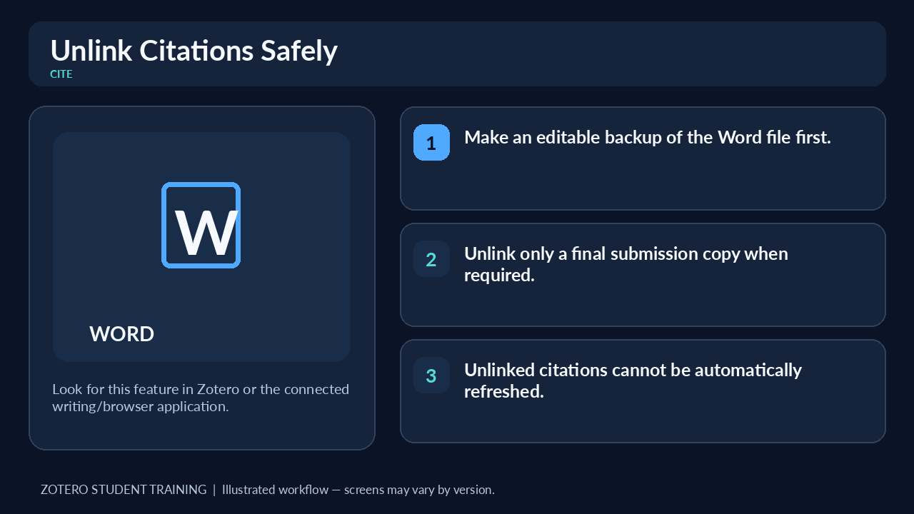

**Try this procedure:**

1. Make an editable backup of the Word file first.
2. Unlink only a final submission copy when required.
3. Unlinked citations cannot be automatically refreshed.

**Warning:** Unlink Citations converts Zotero-managed citations to plain text. Save a separate editable Word copy *before* doing this. Only unlink a final copy if your publisher, editor or submission process specifically asks for it.

**Practice:** explain the risk; do not actually unlink your working thesis.

# Quick Copy and Standalone Bibliography

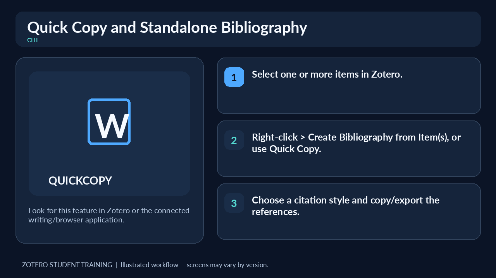

**Try this procedure:**

1. Select one or more items in Zotero.
2. Right-click > Create Bibliography from Item(s), or use Quick Copy.
3. Choose a citation style and copy/export the references.

Use Quick Copy for an email or single-page handout when Word integration is not needed. One route is to select item(s) → right-click → **Create Bibliography from Item(s)** → choose style and output. For longer assignments, prefer live Word citations.

**Practice:** copy a reference list for two selected items to a temporary text file.

# Practice 4 — Write a short academic paragraph (20 minutes)

1. Open a new Microsoft Word document.
2. Write a 100–150 word paragraph about a research topic.
3. Insert at least **two citations** with Zotero.
4. Add a page number where your claim or quotation requires it.
5. Generate an automatic **References** list.
6. Change the style using Document Preferences and switch back.
7. Save the Word file as `Zotero_Practice.docx`.

---

# 8. Share, Synchronize and Discover

# Export and Import References

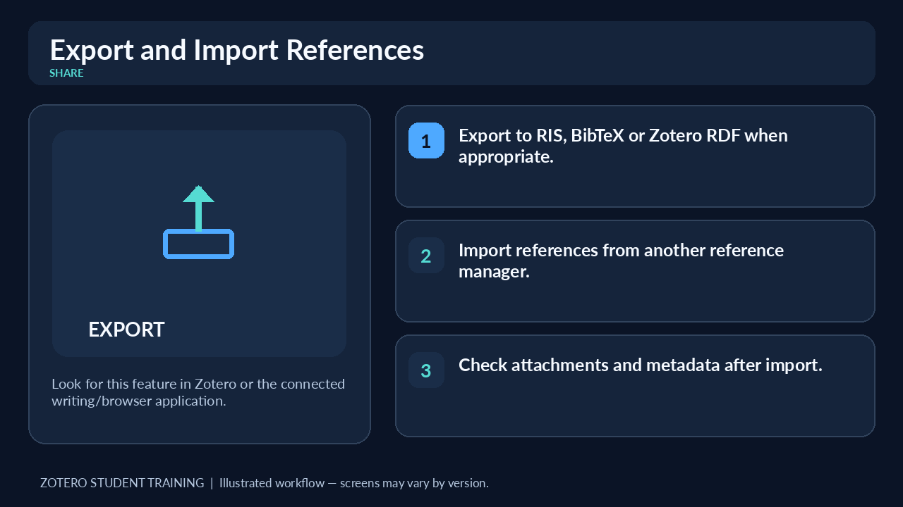

**Try this procedure:**

1. Export to RIS, BibTeX or Zotero RDF when appropriate.
2. Import references from another reference manager.
3. Check attachments and metadata after import.

Common exchange formats: **RIS** (reference managers), **BibTeX** (LaTeX workflows), and **Zotero RDF** (Zotero data exchange). Exports differ in how they handle files, notes and collections, so verify the result.

**Practice:** export a small practice collection as RIS. Keep original items untouched.

# Collaborative Group Libraries

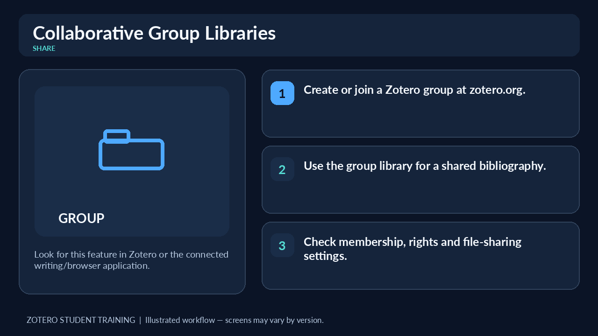

**Try this procedure:**

1. Create or join a Zotero group at zotero.org.
2. Use the group library for a shared bibliography.
3. Check membership, rights and file-sharing settings.

A **group library** is for collaborative bibliography-building. Membership and editing permissions vary with the group's settings. Do not place confidential unpublished documents in a shared group without approval.

**Practice:** in a hypothetical team of three, decide who can add, edit and review the group bibliography.

# RSS Feeds for New Research

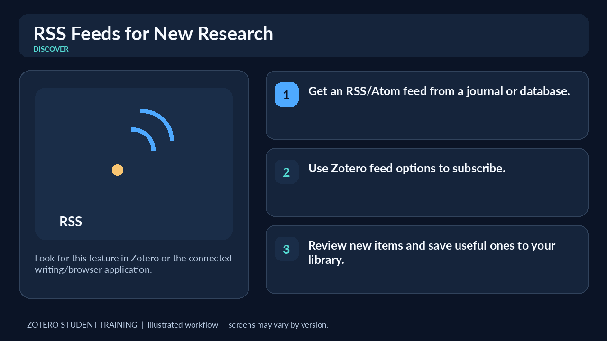

**Try this procedure:**

1. Get an RSS/Atom feed from a journal or database.
2. Use Zotero feed options to subscribe.
3. Review new items and save useful ones to your library.

RSS lets you monitor *new* publications without repeating the same search every day. Save relevant feed items to your real research library after reviewing them.

**Practice:** locate an RSS/Atom feed on a research journal's website and describe how Zotero can subscribe to it.

# Backups and Data Safety

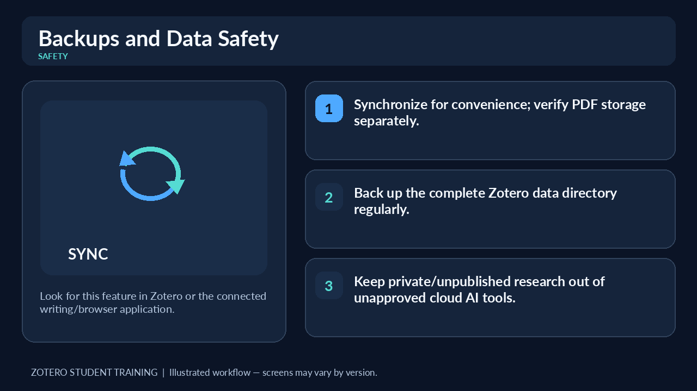

**Try this procedure:**

1. Synchronize for convenience; verify PDF storage separately.
2. Back up the complete Zotero data directory regularly.
3. Keep private/unpublished research out of unapproved cloud AI tools.

Sync is **not a complete substitute for an independent backup**. Follow Zotero's official backup guidance for its data directory, including the database and storage subfolder, and do not move/copy active database files carelessly while Zotero is running.

**Practice:** explain where your primary library lives and how you would safely recover it if the laptop failed.

---

# 9. Advanced Features and Troubleshooting

# Plugins and Optional AI

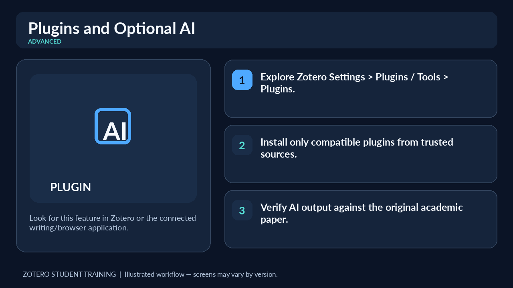

**Try this procedure:**

1. Explore Zotero Settings > Plugins / Tools > Plugins.
2. Install only compatible plugins from trusted sources.
3. Verify AI output against the original academic paper.

Zotero is **not itself a generative AI assistant**. Third-party plugins can add optional capabilities such as PDF Q&A or integrations with external/local language models. Verify compatibility, provenance, privacy terms and each AI-generated claim. Never let an AI-generated citation replace the original bibliographic record.

**Practice:** distinguish core Zotero functionality from what requires an external plugin.

# Common Troubleshooting Steps

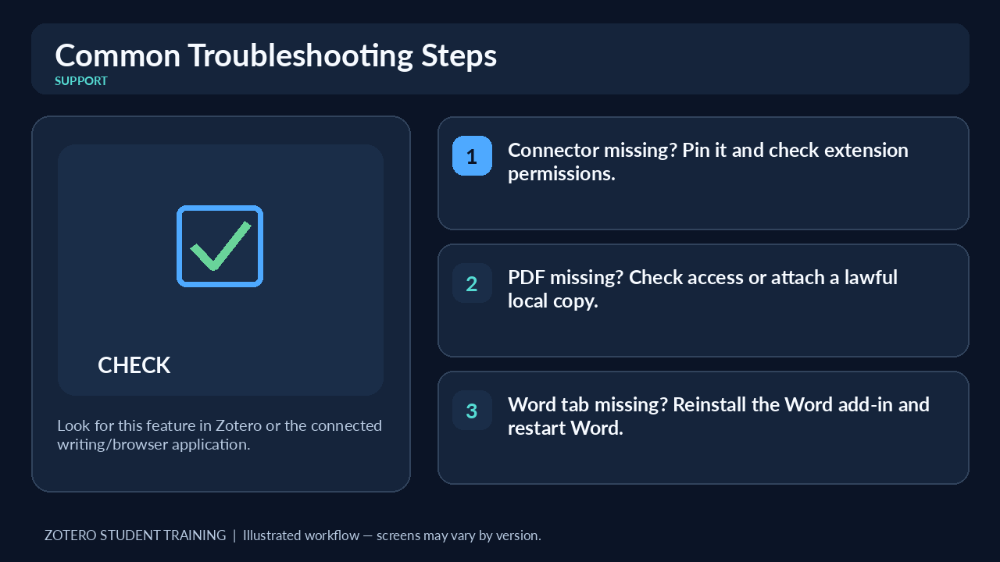

**Try this procedure:**

1. Connector missing? Pin it and check extension permissions.
2. PDF missing? Check access or attach a lawful local copy.
3. Word tab missing? Reinstall the Word add-in and restart Word.

Check the official [Zotero Support](https://www.zotero.org/support/) and [Zotero Forums](https://forums.zotero.org/) for current solutions. Problems often arise because a browser page cannot provide article metadata or PDF access, the Connector has not been installed/enabled, or Word was opened before the plugin was configured.

**Practice:** diagnose a missing Connector, a missing PDF and a missing Word Zotero tab.

---

# 10. Capstone — Complete a Small Literature Review Workflow

# A Complete Literature-Review Workflow

**Try this procedure:**

1. Search and capture evidence from a trusted database.
2. Read, annotate, tag and compare papers.
3. Write in Word with linked citations and a bibliography.

**Example thesis topic:** comparing keyword-based curriculum coding and semantic classification of sustainability-related text. Collect one paper on sustainability/ESD, one on content analysis and one on text classification. Save, verify, tag, annotate, write short notes, and cite the three sources in Word.

**Practice:** follow the complete workflow demonstrated below.

# Final practical demonstration (20–30 minutes)

The instructor demonstrates the complete workflow, then students repeat it on their laptops using **three real academic publications**:

1. Create a main collection and two topic subcollections.
2. Save three publications from Chrome or their DOIs.
3. Check title, authors, year, DOI, and document type.
4. Open a legal PDF copy and make useful highlights and annotations.
5. Create a linked note summarizing the evidence and limitations.
6. Apply meaningful tags and locate the sources again with search.
7. Write a short paragraph in Word and insert two Zotero citations.
8. Add and update a reference list using **Add/Edit Bibliography**.

**Instructor note:** This activity is a guided demonstration, not a test or graded assessment.

---

# 11. Teacher Delivery Guide

| Segment | Time | Demonstration |
|---|---:|---|
| Introduction and installation | 15 min | Zotero vs Connector; account/sync |
| Interface and collections | 20 min | Panels, toolbar, collections, tags |
| Capturing sources | 30 min | Chrome, DOI, PDF, metadata |
| Search and quality control | 15 min | Search, duplicate detection |
| PDF reading and notes | 25 min | Highlights, notes, annotations |
| Citing in Word | 35 min | Citation, page locator, bibliography, refresh |
| Collaboration and safety | 10 min | Groups, sync and plugins |
| Capstone and feedback | 30 min | Three-paper literature-review demonstration |
| **Total** | **180 min** | |

**If teaching a 90-minute class:** cover Sections 1–4, 6–7, and select the Word exercise as homework. Use the next meeting for group libraries, advanced search, and the capstone.

# Troubleshooting checklist for the instructor

- If the browser save icon is missing, check Chrome extensions and pin Zotero Connector.
- If Zotero saves a webpage instead of a journal article, open the publisher's actual publication page and save again; otherwise use DOI.
- If the PDF is missing, verify lawful access via the university library; attach an accessible copy separately.
- If the Zotero Word tab is absent, reinstall the word processor add-in from Zotero settings and restart Word.
- If metadata looks wrong, correct it **before** inserting citations.
- If internet is unavailable, use locally stored PDFs and existing Zotero references; browser capture and some sync functions require connectivity.

---

# 12. Official Resources and Image Attribution

- [Zotero Download + Connector](https://www.zotero.org/download/)
- [Official Zotero Support and Documentation](https://www.zotero.org/support/)
- [Quick Start Guide](https://www.zotero.org/support/quick_start_guide)
- [Collections and Tags](https://www.zotero.org/support/collections_and_tags)
- [Adding Items](https://www.zotero.org/support/adding_items_to_zotero)
- [Zotero Connector](https://www.zotero.org/support/connector)
- [PDF Reader](https://www.zotero.org/support/pdf_reader)
- [Word Processor Plugin](https://www.zotero.org/support/word_processor_plugin_usage)
- [Groups](https://www.zotero.org/support/groups)
- [Backup](https://www.zotero.org/support/zotero_data)
- [LiaScript Documentation](https://liascript.github.io/)

**Images:** The numbered `images/*.png` illustrations in this package were created specifically for this training. The `real_*.png` panels are cropped views of a Zotero screenshot supplied for the course; they depict a specific installation and may differ slightly from the student's interface. Zotero names and icons are used only to identify software functions. No third-party screenshots are silently presented as current Zotero interface images.

**Academic integrity:** Zotero formats citations, but **you** are responsible for source selection, correct claims, bibliographic accuracy, permission to use PDFs, and the final reference style. Optional AI tools may invent facts and must not replace source verification.

