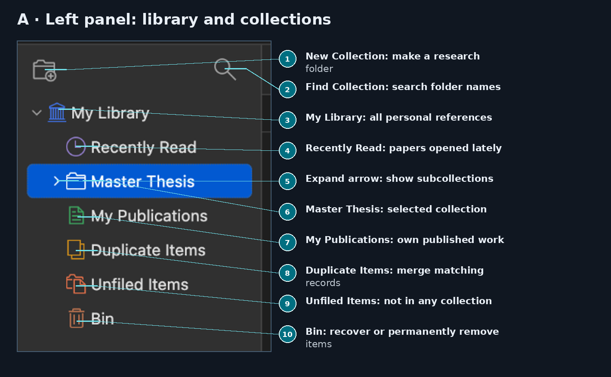
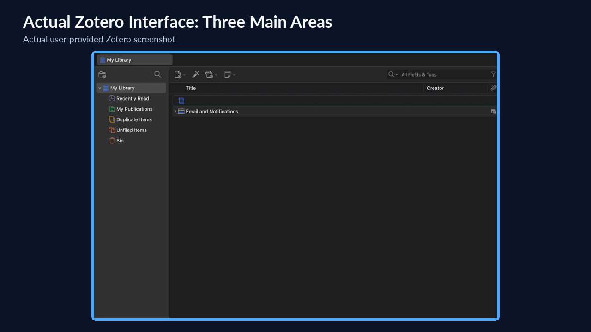
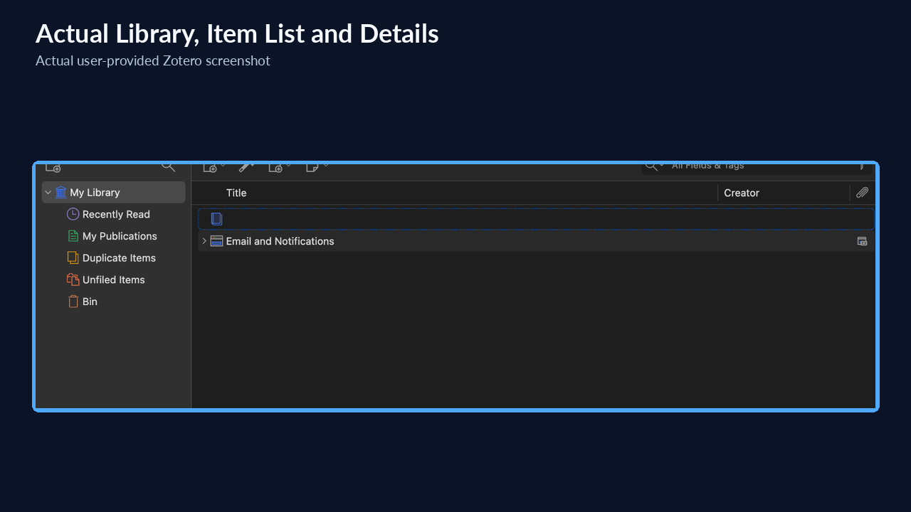
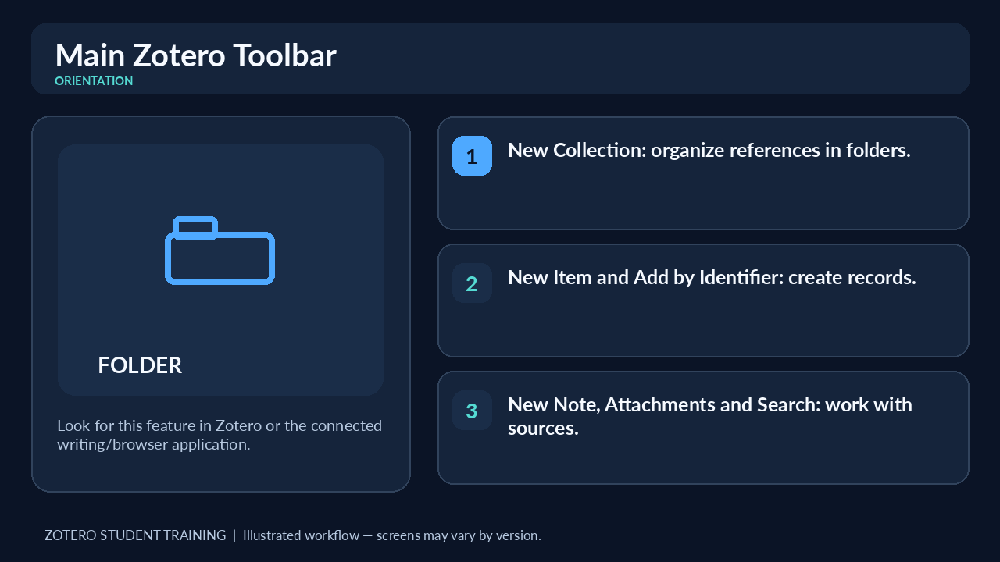
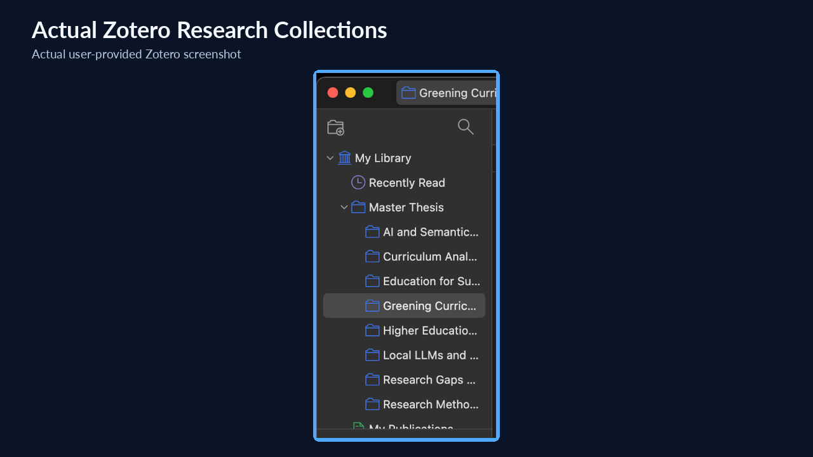
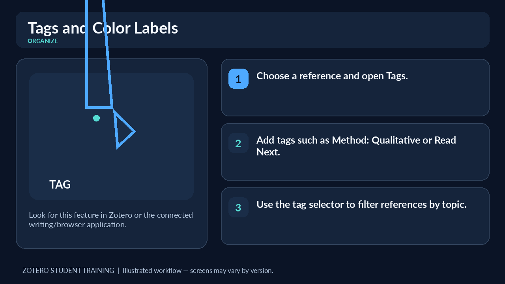
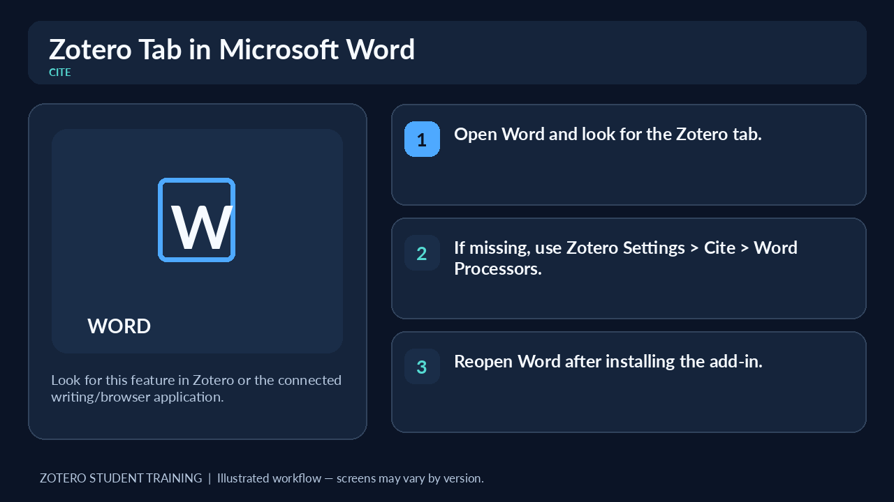
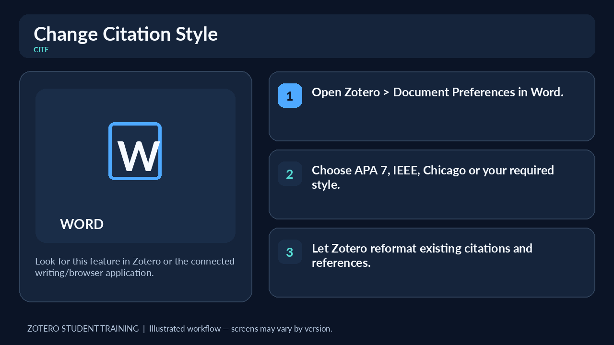
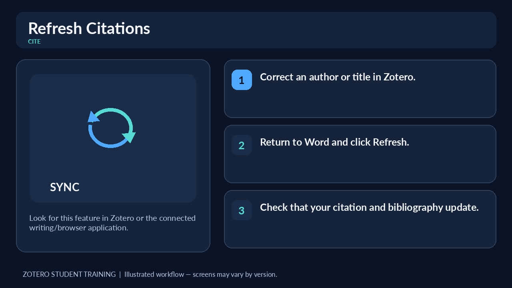

<!--
author: ITVET Academic Skills Training
version: 2.0.0
language: en
narrator: US English Female
comment: Visual, hands-on Zotero training for university students. Includes illustrated explanations and hands-on classroom demonstrations; no quizzes.
-->

# Zotero for Academic Research

## Visual Student Training · Beginner to Advanced

> **Format:** Hands-on LiaScript course · **Suggested time:** 2.5–3 hours · **Level:** University students · **Requirements:** Zotero, Chrome with Zotero Connector, and optionally Microsoft Word.

{{|>}}
Welcome! In this training you will build a research library, collect publications from Chrome, read and annotate PDFs, write structured research notes, and cite your sources in a Word document. Pause after each demonstration to perform the activity on your own computer.

**Learning outcomes** — by the end, you should be able to:

1. Install Zotero and Zotero Connector and identify their different roles.
2. Create collections, tags and saved searches for a research topic.
3. Capture valid references, import PDFs and verify bibliographic metadata.
4. Read, highlight and take linked notes in the PDF reader.
5. Generate accurate Zotero-linked citations and reference lists in Word.
6. Sync and share references responsibly, and explain key limitations.

**Important for visuals:** This course includes actual Zotero screenshots supplied for this training and separate **illustrated workflow diagrams**. The diagrams illustrate where/how features are used; they are not exact screenshots of every software version.

---

# 1. Getting Started and Setup

# 1.1 What is Zotero?

**Zotero is a reference manager**, not a search engine and not an automatic thesis writer. It records academic sources and helps you organize, read, annotate and cite them. It can store PDFs when you have access to those files.

| Research activity | Zotero tool |
|---|---|
| Find papers on the web | Chrome + Zotero Connector |
| Save publication metadata | Connector / Add by Identifier |
| Organize sources | Collections + Tags |
| Read and annotate | Built-in PDF Reader + Notes |
| Write references | Word Zotero Add-in |
| Collaborate | Group Libraries |

# Install Zotero + Connector

**Try this procedure:**

1. Download Zotero from zotero.org/download.
2. Run the Windows installer or move the Mac app to Applications.
3. Add Zotero Connector to Chrome and pin the icon.

**Desktop Zotero** stores and manages your research library. **Zotero Connector** is a *separate browser extension* for capturing sources while browsing.

- Windows: download Zotero, run the installer, then open Zotero from Start.
- macOS: open the `.dmg` and drag Zotero to Applications.
- Chrome: install and pin Zotero Connector from the official download page. Check the publisher before installing.
- Official URLs: [Zotero Downloads](https://www.zotero.org/download/) · [Chrome Connector](https://chromewebstore.google.com/detail/zotero-connector/ekhagklcjbdpajgpjgmbionohlpdbjgc).

**Classroom task:** find the Zotero app and browser Connector. Explain which one captures browser records and which one manages them.

# Accounts and Library Sync

**Try this procedure:**

1. Create or sign into a Zotero account.
2. In Zotero, open Settings and configure your account/sync.
3. Check sync status; PDF file sync depends on storage.

Using Zotero offline does **not** require an account. Sign in when you want to sync metadata and notes between computers. File synchronization has its own capacity limits and settings.

**Classroom task:** locate the sync indicator and explain the difference between a locally stored PDF and a PDF synchronized to cloud storage.

---

# 2. Navigating Zotero

# 2.1 Every Zotero symbol: real screenshot walkthrough

This is an annotated guide to the **Zotero interface in the supplied classroom screenshot**. Your version may look slightly different, but each symbol below has a specific role. Students should keep Zotero open as they follow along.

**Key principle:** Zotero has three panels. The left organizes your research, the middle lists sources, and the right displays the details of the selected source. In this screenshot, **Master Thesis** contains one item and no item is currently selected, so its detail pane is empty.

# 2.2 Left panel — all library icons

| No. | Exact symbol / label | What it does | Student demonstration |
|:--:|---|---|---|
| 1 | Folder with plus: **New Collection** | Creates a research collection (folder). | Create `Literature Review`. |
| 2 | Magnifying glass above folders | Searches the collection list by name. | Find `Master Thesis`. |
| 3 | University/library building: **My Library** | Shows all references stored in your personal library, including items in collections. | Click it and compare with the selected folder. |
| 4 | Clock: **Recently Read** | Lists sources opened recently. | Read a PDF, then return to this view. |
| 5 | Small `>`/`v` arrow next to collection | Expands or collapses its subcollections. | Add and reveal a subcollection. |
| 6 | Blue folder: **Master Thesis** | The currently selected collection; clicking it shows its contents in the center. | Create a subcollection for methodology. |
| 7 | Green page: **My Publications** | Holds records of works you authored or co-authored. | Explain why it differs from a literature collection. |
| 8 | Overlapping orange pages: **Duplicate Items** | Finds likely duplicate references so they can be reviewed and merged. | Check before citing the same paper twice. |
| 9 | Orange/red pages: **Unfiled Items** | Lists items in My Library not assigned to any collection. | File a source into Master Thesis. |
| 10 | Trash can: **Bin** | Holds deleted references for recovery or permanent deletion. | Explain recovery versus permanent removal. |

**Important:** A collection does not create a separate copy of the reference. The same reference can appear in more than one collection.

# 2.3 Middle panel — adding and finding research

| No. | Exact symbol / label | Purpose | Student demonstration |
|:--:|---|---|---|
| 11 | Paper with plus and dropdown: **New Item** | Manually creates a Book, Journal Article, Report or other bibliographic record. | Add a journal article and fill title/author/year. |
| 12 | Magic wand: **Add Item(s) by Identifier** | Retrieves publication metadata from DOI, ISBN or other supported identifier. | Paste a valid DOI for an existing paper. |
| 13 | Stacked page plus: **Add Attachment** | Attaches a local file, stored copy, linked file, or supported web link to a selected reference. | Attach a PDF to an article record. |
| 14 | Note page with dropdown: **New Note** | Creates a note (standalone or attached to a source). | Write a two-sentence paper summary. |
| 15 | Magnifying glass + `All Fields & Tags` | Searches references; dropdown changes search scope. | Search a paper by author. |
| 16 | Funnel inside search box: **Advanced Search** | Applies several filter conditions, such as item type, tag or author. | Filter for journal articles with a selected tag. |
| 17 | **Title** heading | Displays the title of each reference; click to change sort order. | Sort alphabetically. |
| 18 | **Creator** heading | Displays authors/creators; click to sort by creator. | Sort by author surname. |
| 19 | Small paperclip column heading | Indicates attachments associated with items. | Compare a source with and without attached PDF. |
| 20 | Blue book icon on the item row | Indicates an item whose reference type is **Book**. | Click it to display its metadata on the right. |

The small down arrows beside toolbar buttons open additional choices. The paperclip near the column headings is **not** the same control as Add Attachment: one is a list indicator and one is an action.

# 2.4 Right panel — all reference-detail symbols

| No. | Symbol | Purpose | When students use it |
|:--:|---|---|---|
| 21 | Down chevron near the top right | Opens the Zotero tab list/menu. | Switch between open library and reader tabs. |
| 22 | Circular arrows: **Sync** | Synchronizes library information with your Zotero account when configured. | Sync after saving a new paper. |
| 23 | Split-panel rectangle | Controls the item-pane side navigation. | Show or hide the icon rail. |
| 24 | Blue document + `i`: **Info** | Shows editable bibliographic metadata: item type, title, author, date, publication, DOI, etc. | Correct a missing publication year. |
| 25 | Blue lines: **Abstract** | Shows the abstract of a selected article, when available. | Read the abstract before deciding relevance. |
| 26 | Green paperclip: **Attachments** | Shows a reference's PDFs, links, files and previews. | Open an attached PDF. |
| 27 | Yellow note: **Notes** | Displays and creates notes linked to a reference. | Add a research limitation. |
| 28 | Library building + folder: **Libraries and Collections** | Shows where a reference is stored and which collections contain it. | Confirm a paper is in the methodology collection. |
| 29 | Orange tag: **Tags** | Adds subject keywords and classification tags. | Add `quantitative`, `methodology`, or `read`. |
| 30 | Chain: **Related** | Creates links between conceptually related references. | Connect two papers using different methods. |
| 31 | Arrow/circle: **Locate** | Offers ways to locate the item, such as online or through library lookup where configured. | Find a source from its citation. |

The right pane is blank in the screenshot because a collection, rather than an individual item, is selected. **Click the book icon in the center** to see Info, Abstract and other details.

# 2.5 Bottom-left corner — tag controls

| No. | Symbol / text | Purpose |
|:--:|---|---|
| 32 | **No tags to display** | The tag selector currently has no tags to show in this view. |
| 33 | **Filter Tags** text field | Narrows the displayed tag list by text; clicking a tag filters items. |
| 34 | Funnel + dropdown | Opens tag-selector filtering/display options. |

At the bottom-right, **“1 item in this view”** means one Zotero item is visible in the current collection. It is a count, not an additional research tool.

# 2.6 Suggested classroom live demonstration — no quiz

1. Click **Master Thesis** and show the single reference.
2. Click the **blue book icon**. Explain that the right-side **Info** section now shows the source's metadata.
3. Open **Abstract**, **Attachments**, **Notes**, **Tags**, and **Related** one by one. Explain why each is useful for a literature review.
4. Click **New Collection**, create `Research Methodology`, and return to the main collection.
5. Click **New Item** to demonstrate a manual record, then demonstrate **Add Item(s) by Identifier** using a genuine DOI.
6. Attach a PDF, add a note, assign two tags, and run an advanced search with the funnel icon.
7. Show **Duplicate Items**, **Unfiled Items**, and **Bin**; explain which records appear there and why.
8. Finally, click **Sync** and explain that PDF-file syncing depends on settings and available storage.

**Instructor tip:** Have students hover over each icon to read Zotero's own tooltip. Some versions change the icon position while preserving the same function.

---

# 2.1 Real Zotero interface

The screenshot above is from an installed Zotero application. The **left** side contains the library and collections; the **middle** lists references; the **right** displays details for the selected item.

**Instructor demonstration:** select a collection, select a paper, and switch between the Info, Notes and Tags options for that paper.

# Three-Panel Zotero Interface

**Try this procedure:**

1. Left panel: libraries, collections and tags.
2. Middle panel: items, attachments, notes.
3. Right panel: information, notes, tags and item tools.

The Zotero window is divided into three important sections: **Library/collections** on the left, **items list** in the middle, and **item details** on the right. A PDF reader opens when you open an attached PDF.

**Classroom task:** select one item and describe where its title, tags, and attached PDF appear.

# 2.2 Find the real toolbar

The toolbar in an actual installation may show some actions under menu buttons; labels and placement vary by version.

# Main Zotero Toolbar

**Try this procedure:**

1. New Collection: organize references in folders.
2. New Item and Add by Identifier: create records.
3. New Note, Attachments and Search: work with sources.

Tool names and icon arrangements can vary slightly by Zotero version. Learn the **function**, not only the icon shape.

| Tool | Purpose |
|---|---|
| New Collection | Create a project folder / subcollection |
| New Item | Add a reference manually |
| Add by Identifier (magic wand) | Retrieve metadata from DOI, ISBN, PMID and supported IDs |
| New Note | Capture thoughts and reading notes |
| Add Attachment (paperclip) | Add a PDF, file, link, or related attachment |
| Search | Find references and PDF text within the library |

**Classroom task:** locate each of these features in your own Zotero interface.

---

# 3. Build Your Research Library

# 3.1 Example: real collection structure

For practice you may use **any subject**. The screenshot shows a sustainability/curriculum research structure; you can replace these folders with your own thesis or assignment themes.

# Collections and Subcollections

**Try this procedure:**

1. Right-click My Library to create a collection.
2. Use New Subcollection for a research subtopic.
3. Move a reference into several collections without duplicating it.

Collections organize references, not copies of files. **My Library** contains your complete library even when an item belongs to multiple collections.

**Practice:** create `Research Project` → `Background`, `Methods`, `Results`. Add one paper to two collections. Check it is still only one library item.

# Tags and Color Labels

**Try this procedure:**

1. Choose a reference and open Tags.
2. Add tags such as Method: Qualitative or Read Next.
3. Use the tag selector to filter references by topic.

Use tags to represent **cross-cutting themes**, while collections represent project organization. Example tags: `To Read`, `Read`, `Method-Qualitative`, `Method-Quantitative`, `GCI`, `Limitations`, `Key Source`.

**Practice:** add `Read` and `Method-Qualitative` to a source and locate it with the tag selector.
---

# Slide 21 — Write an Assignment with Zotero: What Will We Do?

**Learning activity:** Create a short academic assignment in **Microsoft Word**, with correct **Zotero citations** and an **automatic reference list**.

**Before starting, each student needs:**

- Zotero Desktop installed.
- Microsoft Word installed.
- At least **two real research-paper records** saved in Zotero (preferably with PDFs).
- A research topic, such as *AI in Vocational Education* or a topic of the student's choice.

**Our 5-step workflow:**

1. Connect Zotero with Word.
2. Write a paragraph based on your saved research papers.
3. Add in-text citations using Zotero.
4. Create the APA 7 reference list automatically.
5. Save the finished Word assignment.

**Teacher demonstration:** Open Zotero and Word side by side. Show how a paper in the Zotero collection becomes a citation and full reference in Word.

# Slide 22 — Step 1: Connect Zotero with Microsoft Word

1. Open **Zotero Desktop**.
2. Open **Microsoft Word** and create a blank document.
3. Check whether the **Zotero** tab appears in Word's toolbar.
4. If the tab is missing, go back to Zotero:
   - **Mac:** \`Zotero → Settings → Cite → Word Processors\`.
   - **Windows:** \`Edit → Settings → Cite → Word Processors\`.
5. Click **Install Microsoft Word Add-in** or **Reinstall Microsoft Word Add-in**.
6. Close and reopen Word.

| Zotero button in Word | Function |
|---|---|
| **Add/Edit Citation** | Insert a citation after a statement |
| **Add/Edit Bibliography** | Generate the complete references for papers cited in Word |
| **Document Preferences** | Select APA 7 or another required style |
| **Refresh** | Update citations and references |

**Student action:** Find and click the **Zotero** tab in your Word document.

# Slide 23 — Step 2: Write and Insert In-Text Citations

**Example activity:**

1. In Word, type the title: **The Role of AI in Vocational Education**.
2. Write a short paragraph **in your own words** based on a paper you read.
3. Put the text cursor **at the end of the statement** you want to support.
4. Click **Zotero → Add/Edit Citation**.
5. Search by the paper's **title** or the author's **surname**.
6. Select the **parent article/book record** (not its PDF attachment) and press **Enter/Return** to insert the citation.
7. Repeat these steps when using information from your second paper.

**Illustrative sentence (do not treat this as a verified research finding):**

> Digital tools may support flexible learning in vocational education (Author, 2025).

Zotero will replace the example with the **correct author and publication year** from the actual source you selected.

**Key rule:** A copied PDF highlight or personal Zotero note is **not a citation**. Insert an actual citation through Word's Zotero toolbar.

# Slide 24 — Step 3: Choose APA 7 and Add Page Numbers

1. In Word, click **Zotero → Document Preferences**.
2. Choose **American Psychological Association (APA), 7th edition**.
3. Confirm the selection. Zotero will format your citations in APA 7.
4. Check the Zotero parent record's **author, year, title, journal, and DOI/URL**. Fix missing information in Zotero before finalizing.

**If you quote exact words from a PDF:**

1. Put the copied words in quotation marks.
2. Insert or edit the Zotero citation.
3. Click the selected citation item in the citation dialog.
4. Enter the **real page number** in the **Page** field.
5. Confirm; an APA quotation citation can look like \`(Author, 2025, p. 12)\`.

**Student action:** Set APA 7 and check whether your in-text citations are correctly formatted.

# Slide 25 — Step 4: Generate References/Bibliography Automatically

1. Go to the **last page of your Word assignment**.
2. Add the heading **References**.
3. Place your cursor on a blank line beneath the heading.
4. Click **Zotero → Add/Edit Bibliography**.
5. Zotero creates the **APA 7 reference entries** for the papers you cited in this Word document.
6. Check the names, dates, titles, publication details, and DOI/URL.
7. If you correct metadata in Zotero or add another citation, return to Word and click **Refresh**.

**Remember the difference:**

- **In-text citation:** A short source acknowledgment in your paragraph, such as \`(Author, 2025)\`.
- **Reference:** The full source details in the **References** section.

**Important:** Word's automatic Zotero bibliography includes the sources **cited in your Word document**, not every paper in Zotero.

# Slide 26 — Final Activity: Submit a Word Assignment with Zotero Citations

**Students: Do this practical task in class. No quiz.**

1. Create a Word document named \`Zotero_Assignment.docx\`.
2. Add your own academic topic as a heading.
3. Select **two papers** already saved in your Zotero collection.
4. Write **100–150 words in your own words**, using findings from both papers.
5. Insert **at least two Zotero citations** using **Add/Edit Citation**.
6. Use **APA 7th edition** in **Document Preferences**.
7. Add a **References** heading at the end of the Word document.
8. Click **Add/Edit Bibliography** to generate the complete references.
9. Click **Refresh** and check the accuracy of both citations and references.
10. Save the document. Show the instructor the two live citations and the automatically generated reference list.

**Expected result in Word:**

- **Assignment paragraph:** Your original writing, with two citations.
- **References section:** Two correctly formatted APA 7 entries created by Zotero.
- **File to submit:** \`Zotero_Assignment.docx\`.

**Official help:** [Using Zotero with Microsoft Word](https://www.zotero.org/support/word_processor_plugin_usage) · [Creating bibliographies](https://www.zotero.org/support/creating_bibliographies)

